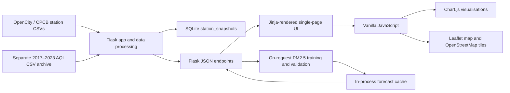

<h1 align="center">AirGuard 🌿</h1>

<p align="center">
  <strong>Breathe Smarter. Live Healthier.</strong><br>
  Hyderabad air-quality intelligence, historical analysis, station comparisons, and a carefully qualified PM2.5 forecast.
</p>

<p align="center">
  <a href="https://github.com/NavyaSwamy/AirGuard-Hyderabad"></a>
  <a href="https://navyaswamy.github.io/AirGuard-Hyderabad/"></a>
  
  
  
  
  
</p>

<p align="center">
  
  <br>
  <sub>Existing homepage hero image; photo by Joydeep via Wikimedia Commons, licensed CC BY-SA 3.0.</sub>
</p>

> **At a glance:** AirGuard is a Flask web app for exploring historical OpenCity/CPCB measurements from 14 Hyderabad monitoring stations. It combines station-level pollutant views, an explicitly custom risk indicator, approximate locality map references, a separately sourced historical AQI archive, station comparisons, and a recursively evaluated 24-hour PM2.5 forecast. It is not a live monitoring service or a medical product.

> **Live app:** [https://navyaswamy.github.io/AirGuard-Hyderabad/](https://navyaswamy.github.io/AirGuard-Hyderabad/)

## Contents

- [Project overview](#project-overview)
- [Problem and objectives](#problem-and-objectives)
- [Features and implementation status](#features-and-implementation-status)
- [Screenshots](#screenshots)
- [Data sources and coverage](#data-sources-and-coverage)
- [Preprocessing and data quality](#preprocessing-and-data-quality)
- [Forecasting methodology](#forecasting-methodology)
- [Model evaluation](#model-evaluation)
- [System architecture](#system-architecture)
- [Technology stack](#technology-stack)
- [Project structure](#project-structure)
- [Setup on macOS](#setup-on-macos)
- [Data, database, and model workflow](#data-database-and-model-workflow)
- [Run the application](#run-the-application)
- [Deploy online](#deploy-online)
- [GitHub Pages limitations](#github-pages-limitations)
- [HTTP API](#http-api)
- [Dashboard and visualisations](#dashboard-and-visualisations)
- [Progressive Web App](#progressive-web-app)
- [Limitations and responsible use](#limitations-and-responsible-use)
- [Planned enhancements](#planned-enhancements)
- [Research and potential impact](#research-and-potential-impact)
- [Contributing](#contributing)
- [License](#license)
- [Acknowledgements and references](#acknowledgements-and-references)
- [Author](#author)

## Project overview

**AirGuard — An Air-Quality Monitoring, Forecasting, and Exposure-Planning Platform for Hyderabad, Telangana, India** is a single-page web application backed by Python and Flask. It presents recorded station measurements and historical AQI data through interactive charts, a Hyderabad map, and station comparison tools.

The application separates three kinds of information:

1. **Pollutant concentrations:** 15-minute station observations from 2024–2025, aggregated where needed for hourly charts and PM2.5 forecasting.
2. **Historical AQI:** a separate hourly AQI archive from 2017–2023. It has no pollutant sub-index breakdown and its timestamp timezone is unspecified.
3. **AirGuard Risk Index:** a project-defined indicator derived from available measurements. It is not CPCB AQI and must not be interpreted as an official health standard.

The “personal” guidance is a transparent, rule-based interpretation of recorded station data and historical time-of-day patterns. It is not a personalized machine-learning model, a real-time recommendation, or medical advice.

## Problem and objectives

Air-quality information can be difficult to interpret when measurements, AQI values, forecasts, and location references are presented as if they were interchangeable. AirGuard aims to make the available Hyderabad data easier to explore while keeping its provenance and limitations visible.

- Explore measurements and historical AQI by monitoring station.
- Compare station records and view monthly pollutant patterns.
- Evaluate a PM2.5 forecasting approach against a persistence baseline.
- Present simple outdoor-planning information without claiming medical validity.
- Make missing readings, historical timestamps, approximate map locations, and model uncertainty explicit.

## Features and implementation status

| Status | Feature | What is implemented |
|---|---|---|
| ✅ Implemented | Station dashboard | Latest available source record, pollutant values, observation time, and AirGuard Risk Index for a selected station. |
| ✅ Implemented | Historical AQI view | Hourly AQI archive from 2017–2023, shown separately from pollutant concentrations. |
| ✅ Implemented | Map and station search | Leaflet map with approximate OpenStreetMap locality/place references, station search, and station details. Pins are not verified monitor coordinates. |
| ✅ Implemented | Trends and comparison | Monthly PM2.5/PM10 averages, recent station comparisons, and historical time-of-day PM2.5 profiles. |
| ✅ Implemented | PM2.5 forecast | A station-specific recursive 24-hour forecast is returned only when the configured horizon validation passes. |
| ✅ Implemented | Personal AirGuard | Rule-based informational guidance based on the selected station's recorded index, activity, duration, and past time-of-day profile. |
| ✅ Implemented | Exposure estimator | A concentration × planned-duration estimate, explicitly not an inhaled dose or forecast. |
| ✅ Implemented | Web experience | Responsive single-page navigation, English/Telugu text, light/dark themes, loading and error messages, and a nature-photo breathing pause. |
| ⚠️ Limited | Offline support | Service worker caches a static app shell; it does not make the API, forecast, external map tiles, or CDN libraries available offline. |
| ❌ Not implemented | Live air-quality feed | The checked-in data is historical; the application does not connect to a live sensor service. |
| ❌ Not implemented | Verified monitor coordinates | Source data has no confirmed sensor coordinates; map points are contextual locality references. |
| ⚙️ Configured | GitHub Pages | GitHub Actions publishes the interactive frontend and a pre-generated data/forecast snapshot at the project link above. |
| ❌ Not implemented | Medical or route-specific advice | No medical validation, personal sensor input, route-level exposure model, or clinical recommendation is provided. |

The current interface is a single page with hash-based sections, not a set of independently routed pages.

## Screenshots

No product screenshots were found in the repository during this documentation review. The Charminar image above is an existing homepage asset, **not** a screenshot of the running application.

Screenshots can be added later under a directory such as `docs/screenshots/`, after capturing the actual application:

- Desktop homepage and station dashboard.
- Map with a station popup and the approximate-location disclosure visible.
- Forecast chart with its evaluation details.
- Mobile layout showing navigation and a chart or station card.

Until those images exist, this README intentionally does not link to invented screenshot paths.

## Data sources and coverage

The source files are checked into this repository under `data/raw/`; a fresh clone does not require a separate dataset download.

### 15-minute pollutant concentration feed

| Property | Verified coverage |
|---|---|
| Source | [OpenCity — Hyderabad Hourly Air Quality Reports](https://data.opencity.in/dataset/hyderabad-hourly-air-quality-reports), with local station CSVs attributed to OpenCity/CPCB |
| Files | 14 station CSVs in `data/raw/fifteen_min_2024_25/` |
| Stations | 14 |
| Rows | 980,359 |
| Sampling interval | 15 minutes |
| Timestamp coverage | 2024-01-01 00:00 UTC through 2025-12-31 23:45 UTC |
| Pollutant fields | PM2.5, PM10, NO, NO2, NOx, NH3, SO2, CO, and ozone |
| Missing data | Present in all nine pollutant fields; missing values are not treated as zero |
| Duplicate station/timestamp pairs | 0 in the checked-in data-quality report |

PM2.5/PM10 and most listed gases are represented in µg/m³; CO is in mg/m³ and NOx is in ppb. The application dashboard displays the measurements it uses for its current station view; the raw data also contains NO, NH3, and NOx.

Pollutant availability across all 980,359 source rows, as recorded in the checked-in quality report:

| Pollutant field | Non-missing rows | Missing rows |
|---|---:|---:|
| PM2.5 (µg/m³) | 791,064 | 189,295 |
| PM10 (µg/m³) | 712,355 | 268,004 |
| NO (µg/m³) | 808,470 | 171,889 |
| NO2 (µg/m³) | 808,669 | 171,690 |
| NOx (ppb) | 803,725 | 176,634 |
| NH3 (µg/m³) | 700,446 | 279,913 |
| SO2 (µg/m³) | 781,224 | 199,135 |
| CO (mg/m³) | 807,044 | 173,315 |
| Ozone (µg/m³) | 802,266 | 178,093 |

The station names represented in the feed are Sanathnagar, New Malakpet, Somajiguda, IITH Kandi, Kokapet, ECIL Kapra, Ramachandrapuram, Nacharam_TSIIC IALA, Kompally Municipal Office, Central University, ICRISAT Patancheru, IDA Pashamylaram, Bollaram Industrial Area, and Zoo Park.

### Separate historical AQI archive

| Property | Verified coverage |
|---|---|
| Source | OpenCity/CPCB hourly AQI CSV archive for Hyderabad |
| Files and stations | 14 station archives |
| Valid AQI observations | 388,338 |
| Timestamp coverage | 2017-02-02 00:00 through 2023-12-31 23:00 |
| Format | Monthly grids containing day rows and 24 hourly values |
| Timezone | Not specified in the source; retained as source-local timestamps |
| Pollutant sub-index breakdown | Not included |

These AQI records are **not** merged with the 2024–2025 concentration feed. The app does not infer a dominant pollutant from archived AQI values or present them as current conditions.

### Station map references

The source records do not provide verified monitoring-device coordinates. The map uses OpenStreetMap place/locality search references for geographic context. These approximate points must not be interpreted as sensor positions or as air-quality estimates for every place in Hyderabad.

## Preprocessing and data quality

- The Flask data loader reads the station CSV files, parses timestamps as UTC, converts pollutant fields to numeric values, and combines the station records for the application.
- Invalid timestamps are excluded. Invalid or absent pollutant values become missing values; they are not silently replaced with zero.
- The checked-in quality report records 980,359 rows and no duplicate station/timestamp pairs. Missing observations remain substantial and vary by pollutant.
- Monthly concentration charts aggregate the source values by UTC month. The forecast target is the hourly mean PM2.5 concentration.
- The older AQI archive is parsed independently, preserving its source-local timestamp convention and hourly AQI values.
- A missing pollutant reading results in an unavailable station index rather than a fabricated zero score.
- The station index averages the available normalized components for PM2.5, PM10, NO2, SO2, CO, and ozone, using project-defined reference denominators and a 0–100 cap. Its labels and thresholds are application-specific, not official AQI categories.
- The SQLite snapshot table is rebuilt from the station CSVs when `app.py` is imported; report JSON files are also generated during this initialization.

The detailed checked-in reports are in [`reports/`](reports/), including the dataset inventory, data quality, data dictionary, station coverage, preprocessing, and model evaluation reports.

## Forecasting methodology

The implemented model forecasts **hourly mean PM2.5 concentration in µg/m³**. It does not forecast official AQI.

1. Parse valid station timestamps as UTC and coerce PM2.5 values to numeric.
2. Resample PM2.5 into hourly means; hours with no observation remain missing.
3. Build supervised features from PM2.5 lags at 1, 2, 3, 6, 12, and 24 hours, plus cyclical hour-of-day, weekday, and day-of-year features.
4. Fit `sklearn.ensemble.HistGradientBoostingRegressor` with 160 iterations, at most 15 leaf nodes, L2 regularization of 1.0, and random seed 42.
5. Split the supervised series chronologically: the first 80% is training data and the final 20% is a holdout.
6. Evaluate recursive 24-hour windows at daily origins in the holdout. A window is used only when its required history and 24 actual hourly targets are present. A small input-history gap may be forward-filled for up to three hours.
7. Require at least three complete 24-hour origins before exposing a forecast. The forecast is recursive: each prediction becomes input to later forecast hours.
8. Compare against a persistence baseline that repeats the latest historical hourly PM2.5 value.
9. After evaluation, refit on the eligible pre-forecast data and produce the next 24 hourly predictions.

The current app trains when a forecast is requested and caches the result in process memory. There is no serialized trained-model artifact checked into the repository.

### Split terminology

The implementation has a chronological **80% training / 20% holdout** split, with rolling 24-hour evaluation windows drawn from that holdout. It does **not** define three separate train, validation, and untouched test partitions. The reported numbers should therefore be read as holdout/rolling-origin results, not as performance on an independent external test set.

## Model evaluation

The checked-in evaluation report was generated on **2026-11-12** from the 2024–2025 station feed. Each station reports recursive 24-hour holdout metrics. Aggregate figures below are **unweighted means of the 14 station-level metrics**, not pooled observation-level metrics.

| Metric | Mean across 14 stations |
|---|---:|
| Model MAE | 4.81 µg/m³ |
| Persistence-baseline MAE | 7.19 µg/m³ |
| Model RMSE | 6.90 µg/m³ |
| Model R² | -0.174 |
| Stations where model MAE beats persistence | 10 of 14 |

The negative mean R² and station-level results show that performance is uneven. The model should not be described as universally accurate or superior to the baseline.

| Station | Model MAE (µg/m³) | Persistence MAE (µg/m³) | Model R² | 24-hour origins |
|---|---:|---:|---:|---:|
| Bollaram Industrial Area | 7.02 | 6.81 | 0.469 | 10 |
| Central University | 3.90 | 5.37 | 0.211 | 5 |
| ECIL Kapra | 2.75 | 2.33 | -0.499 | 14 |
| ICRISAT Patancheru | 8.71 | 10.61 | 0.486 | 14 |
| IDA Pashamylaram | 5.98 | 8.97 | 0.084 | 13 |
| IITH Kandi | 2.15 | 2.13 | 0.367 | 7 |
| Kokapet | 1.62 | 2.00 | 0.056 | 19 |
| Kompally Municipal Office | 0.86 | 3.86 | 0.883 | 3 |
| Nacharam_TSIIC IALA | 2.52 | 2.81 | -0.035 | 12 |
| New Malakpet | 2.26 | 2.59 | -0.052 | 14 |
| Ramachandrapuram | 5.74 | 26.82 | -4.123 | 14 |
| Sanathnagar | 7.88 | 5.70 | -0.709 | 14 |
| Somajiguda | 7.85 | 11.26 | 0.110 | 7 |
| Zoo Park | 8.09 | 9.43 | 0.317 | 16 |

The large negative R² at Ramachandrapuram and the stations where persistence has lower MAE are important limitations, not values to omit. The complete checked-in report also contains RMSE, one-hour metrics, training/holdout periods, and per-station evaluation details: [`reports/model_evaluation.json`](reports/model_evaluation.json).

## System architecture



The diagram describes the checked-in application. The map's place references are approximate; map tiles are provided by OpenStreetMap. The chart and map libraries are loaded by the browser from CDNs.

## Technology stack

| Area | Verified technologies |
|---|---|
| Frontend | HTML5, CSS3, vanilla JavaScript, Jinja templates |
| Backend | Python, Flask 3.1.3 |
| Data and machine learning | pandas 3.1.1, NumPy 2.5.4, scikit-learn 1.9.1, `HistGradientBoostingRegressor` |
| Database | SQLite, accessed through Python's built-in `sqlite3` module |
| Charts | Chart.js, loaded from jsDelivr without a pinned version |
| Maps | Leaflet 1.9.4 and OpenStreetMap |
| Browser application support | Web App Manifest and service worker |
| Deployment | Flask development server locally; GitHub Actions and GitHub Pages for the static hosted version |

Python dependency pins are listed in [`requirements.txt`](requirements.txt). The GitHub Pages workflow uses Python 3.13. No Node.js build pipeline, Docker setup, or external hosting provider is required.

## Project structure

```text
.
├── app.py                         # Flask routes, data loading, SQLite and report generation
├── airguard_forecasting.py        # PM2.5 features, model training and validation
├── PROJECT_REPORT.md              # Existing project report
├── requirements.txt               # Pinned Python dependencies
├── .github/
│   └── workflows/
│       └── github-pages.yml       # Builds and deploys the GitHub Pages site
├── data/
│   ├── raw/
│   │   ├── fifteen_min_2024_25/   # 14 pollutant concentration CSVs
│   │   ├── hourly_2017_2023/      # Historical AQI archive CSVs
│   │   ├── metadata/              # Source package metadata
│   │   └── download_manifest.json
│   └── processed/
│       ├── airguard.db            # SQLite station_snapshots database
│       └── station_locations.json # Approximate OSM place references
├── reports/                       # Data quality, inventory and model reports
├── scripts/
│   ├── build_github_pages.py      # Exports static API and forecast snapshots for Pages
│   └── train_forecasts.py         # Batch station evaluation report generator
├── static/
│   ├── app.js
│   ├── styles.css
│   ├── sw.js
│   ├── manifest.webmanifest
│   ├── images/
│   └── icons/
├── templates/
│   └── index.html
└── tests/                         # unittest data-quality and forecasting tests
```

## Setup on macOS

### Prerequisites

- macOS with Git and Python 3 installed.
- A Python version compatible with the pinned packages. The repository does not pin or declare a supported Python version.

### Clone and create a virtual environment

```bash
git clone https://github.com/NavyaSwamy/AirGuard-Hyderabad.git
cd AirGuard-Hyderabad

python3 -m venv .venv
source .venv/bin/activate
python -m pip install --upgrade pip
python -m pip install -r requirements.txt
```

### Dataset placement

The required CSV files are included in the repository under `data/raw/fifteen_min_2024_25/` and `data/raw/hourly_2017_2023/`. No extra download or manual copy step is needed for a normal clone. If replacing or supplying data, preserve those directories and the station CSV naming convention expected by `app.py`.

### Database initialization

There is no separate migration command. Importing `app.py` loads the station CSVs, creates or refreshes `data/processed/airguard.db`, and populates the `station_snapshots` table. It also regenerates the data report JSON files in `reports/`.

The database contains 14 station snapshots. Its table columns are `station_name`, `station_display`, `timestamp`, `risk_score`, `risk_label`, `pm25`, `pm10`, `no2`, `so2`, `co`, and `o3`.

## Data, database, and model workflow

### Train and evaluate all stations

From the activated virtual environment:

```bash
python scripts/train_forecasts.py
```

The script evaluates eligible station series and writes `reports/model_evaluation.json`. The forecast API also trains a station model on request; it does not load a pre-trained model file. Forecast results are cached in memory for the running process and are not persisted as model weights.

### Run the tests

```bash
python -m unittest discover -s tests -v
```

The tests cover forecasting horizon and validation gates, short or missing data behavior, AQI archive parsing, station data quality, and API data separation.

## Run the application

Start the app with:

```bash
python app.py
```

The configured Flask development server binds to `0.0.0.0` and defaults to port `5001`. Open:

**http://127.0.0.1:5001**

To select another port:

```bash
PORT=5002 python app.py
```

The checked-in entry point runs with `debug=True`; this is only used by the local development server.

## Deploy online

### Open the published app

**[Open AirGuard on GitHub Pages](https://navyaswamy.github.io/AirGuard-Hyderabad/)**

The first Pages deployment is complete. Subsequent pushes to `main` trigger a fresh static snapshot deployment.

The GitHub Actions workflow rebuilds and publishes the site on every push to `main`. Follow the `Deploy AirGuard to GitHub Pages` workflow in the repository's **Actions** tab to monitor deployments.

The workflow uses the repository's checked-in datasets to precompute the station API responses and validated 24-hour forecasts. The published page loads this generated snapshot in the browser; it does not start a Flask server.

### Rebuild the static site locally

```bash
python scripts/build_github_pages.py --output _pages-preview
```

Open `_pages-preview/index.html` through a local static HTTP server to preview the export. The `_pages-preview/` directory is ignored by Git.

## GitHub Pages limitations

GitHub Pages serves static files only. It cannot run Flask, SQLite, or on-request model training. AirGuard therefore publishes a pre-generated snapshot of station data and forecasts when the workflow runs. The dashboard is interactive, but its readings and predictions remain fixed until another successful deployment. This is historical data—not a live feed—and link availability depends on GitHub Pages.

## HTTP API

All documented application endpoints are defined as Flask routes without custom methods, so they use Flask's default `GET` behavior. Station names should be URL-encoded when they contain spaces, commas, or other reserved characters.

| Method | Endpoint | Parameters | Response |
|---|---|---|---|
| GET | `/` | — | Jinja-rendered single-page application |
| GET | `/api/summary` | — | `meta` and latest station summary objects, including source-data notes |
| GET | `/api/insights` | — | `insights` object with the custom index summary for the latest source snapshot |
| GET | `/api/station/<station_name>` | Path station name | Latest station record, available pollutant fields, and recent trend points |
| GET | `/api/historical-aqi/<station_name>` | Path station name | Historical AQI source, latest archived record, archive range, monthly means, and `pollutant_breakdown: null` |
| GET | `/api/monthly-trends/<station_name>` | Path station name | Monthly PM2.5/PM10 means and sample counts from the concentration feed |
| GET | `/api/time-profile/<station_name>` | Path station name | Hour-of-day PM2.5 means from the most recent 30-day source window, labelled `Asia/Kolkata` |
| GET | `/api/forecast/<station_name>` | Path station name | Hourly history, validated model metrics, and 24 forecast points when the validation gate passes |
| GET | `/api/compare` | Repeated `stations` query parameter; optional | Up to the requested stations' latest 48 source points; if omitted, the first source station is selected |
| GET | `/api/model-metrics` | — | Evaluation model metadata for the first station in the loaded source data |
| GET | `/manifest.webmanifest` | — | Web app manifest |

For comparison, repeat the query parameter, for example:

```text
/api/compare?stations=Somajiguda%2C%20Hyderabad%20-%20TSPCB&stations=Kokapet%2C%20Hyderabad%20-%20TSPCB
```

Unknown station names return a JSON `{"error":"Station not found"}` response with HTTP 404. The forecast endpoints return HTTP 422 with an `error` and `station_name` when there is insufficient eligible history or too few complete validation windows.

### Representative response

The following is an abridged example of the `/api/summary` shape. The station values are a historical source record, not a live reading; fields not shown are omitted for brevity.

```json
{
  "meta": {
    "station_count": 14,
    "sample_count": 980359,
    "source_note": "Local 15-minute OpenCity / CPCB station CSV observations, 2024-2025; not a live feed"
  },
  "stations": [
    {
      "station_display": "New Malakpet, Hyderabad",
      "timestamp": "2025-12-31T23:45:00+00:00",
      "risk_score": 42.1,
      "PM2.5": 48.1,
      "PM10": 92.78
    }
  ]
}
```

The `/api/forecast/<station_name>` result includes `model.validated_horizon_hours`, `model.validation_origins`, `model.metrics`, `model.persistence_baseline`, `forecast_horizon_hours`, and a `forecast` array of timestamped predictions. Forecast timestamps and values depend on the selected station's source data and are generated at request time.

## Dashboard and visualisations

- **Station dashboard:** pollutant values, observation timestamp, custom station index, and a short recent PM2.5 trend.
- **Monthly insights:** source-timestamp monthly means for PM2.5 and PM10.
- **Historical AQI:** separate 2017–2023 monthly AQI averages; source timezone is unspecified.
- **Station comparison:** recent PM2.5 series across selected monitoring stations.
- **Forecast chart:** actual hourly history and model predictions are shown as separate series, with model metrics and the persistence baseline.
- **Map:** interactive Leaflet map with station cards and approximate locality/place pins. It does not interpolate air-quality values between stations.
- **Personal and exposure tools:** informational planning based on historical station data, with explicit caveats in the UI.

Charts are rendered in the browser with Chart.js. The map uses Leaflet and OpenStreetMap tiles with attribution.

## Progressive Web App

The repository includes a web app manifest, SVG icons, and a service worker. The Flask-served version registers the service worker, which pre-caches the main page and selected local static assets. The GitHub Pages build intentionally does not register that worker because the project site is hosted below a repository subpath.

Offline behavior is limited:

- API requests are not cached as usable readings; while offline they return a JSON 503 error.
- OpenStreetMap tiles and CDN-hosted Leaflet/Chart.js assets may not be available without a network connection.
- No push notifications, background synchronization, or offline forecast computation is implemented.

## Limitations and responsible use

- **Historical, not live:** the latest display refers to the latest record in the local archive, which ends in 2025. It is not a current city reading.
- **Different data products:** the 2017–2023 AQI archive and 2024–2025 pollutant concentrations are separate sources and periods.
- **Custom indicator:** AirGuard Risk Index values and labels are project-defined and are not official AQI values.
- **Approximate mapping:** OpenStreetMap place references are not verified air-monitor coordinates. A station's reading is not a measured value for every nearby neighborhood.
- **Forecast uncertainty:** station-level model results vary; the mean R² is negative and the model loses to persistence at some stations.
- **No medical validation:** the guidance is informational and is not health or medical advice.
- **Exposure estimator:** concentration multiplied by planned duration is not inhaled dose, personal exposure, or a future concentration estimate.
- **Missing observations:** pollutant availability differs by station and time. A blank value means unavailable, not zero.
- **Local development server:** `debug=True` is enabled only when running `python app.py`; GitHub Pages does not host the Flask server.
- **Static deployment:** published readings and forecasts are snapshots generated by GitHub Actions, not live API responses.

## Planned enhancements

These are potential future directions, not features currently claimed as implemented:

- Integrate a maintained, documented live-data source with clear provenance and freshness indicators.
- Obtain authoritative monitor coordinates and validate station metadata before replacing approximate map references.
- Improve forecasting with stronger baselines, time-based backtesting, uncertainty intervals, and station-specific error analysis.
- Add explicit data-versioning and model-artifact management if reproducible offline inference becomes a requirement.
- Add automated checks for the GitHub Pages build and improve visibility into snapshot freshness.
- Capture and maintain real desktop and mobile product screenshots.

## Research and potential impact

AirGuard provides a small, inspectable example of turning public station records into a user-facing data application. It can support learning and discussion about time-series preprocessing, missing sensor data, forecasting evaluation, AQI interpretation, and responsible communication of uncertainty.

Its potential value to Hyderabad residents, students, and researchers is exploratory. The project does not measure changes in health outcomes, pollution exposure, or public behavior, and no such impact is claimed.

## Contributing

Contributions are welcome through GitHub issues and pull requests:

1. Open an issue describing the proposed change or verified data problem.
2. Keep observations, AQI, custom scores, and forecasts clearly distinguished.
3. Do not add fabricated readings, coordinates, metrics, or deployment claims.
4. Make a focused change and add or update tests for behavior changes.
5. Run the test command documented above and describe the results in the pull request.

No separate `CONTRIBUTING.md` is currently present.

## License

No root `LICENSE` file was present when this README was prepared, so **the application source-code license is unspecified**. Do not assume that the repository's code is open-source licensed until a license is added.

The checked-in OpenCity package metadata labels the source data as public domain. The homepage Charminar photograph is credited in the application to Joydeep / Wikimedia Commons under CC BY-SA 3.0. Other asset terms remain subject to their respective source pages.

## Acknowledgements and references

- [OpenCity Hyderabad air-quality dataset](https://data.opencity.in/dataset/hyderabad-hourly-air-quality-reports) and its OpenCity/CPCB station CSV resources.
- [Central Pollution Control Board (CPCB)](https://cpcb.nic.in/) for the AQI framework referenced by the historical AQI archive.
- [OpenStreetMap contributors](https://www.openstreetmap.org/copyright) for map data and contextual locality references.
- [Leaflet](https://leafletjs.com/) and [Chart.js](https://www.chartjs.org/) for browser mapping and charting.
- [Charminar image source](https://commons.wikimedia.org/wiki/File:Charminar_12032013.jpg): Joydeep / Wikimedia Commons, CC BY-SA 3.0.
- Nature photography is credited in the application to [Unsplash](https://unsplash.com/).

## Author

**Navya Swamy**

[GitHub profile](https://github.com/NavyaSwamy) · [AirGuard repository](https://github.com/NavyaSwamy/AirGuard-Hyderabad)
